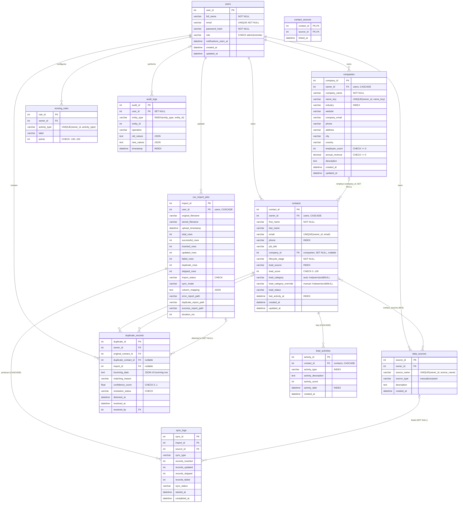

# MarTech CRM: Entity-Relationship Diagram

## Design notes

* **Normalisation (3NF).** Company attributes live only in `companies`; contacts reference them through
  `company_id`. Lead score and category are attributes of a contact (a lead is a contact in a
  pre-customer lifecycle stage), so there is no redundant `leads` table.
* **One-to-many:** company → contacts, contact → activities, import job → sync logs, user → everything they own.
* **Many-to-many:** `contact_sources` records every data source (manual entry, seed data, CSV import) that
  created or updated a contact.
* **Referential integrity / deletion policies:** deleting a company sets `contacts.company_id` to NULL
  (contacts survive), deleting a contact cascades to its activities, deleting a user cascades to their data.
  SQLite enforces this with `PRAGMA foreign_keys=ON`; MySQL/InnoDB enforces it natively.
* **Uniqueness under concurrency:** `UNIQUE(owner_id, email)` on contacts and `UNIQUE(owner_id, name_key)` on
  companies make concurrent imports unable to create duplicates. A conflicting import fails with an
  IntegrityError and is rolled back completely.
* **Ownership:** every CRM table carries `owner_id` / `user_id`; every query filters on the logged-in user.
* The generated MySQL 8 DDL is in [`schema_mysql.sql`](schema_mysql.sql) (from `flask db upgrade --sql`).
